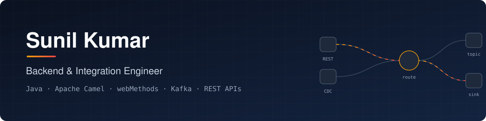

  
  

I'm a **Software Engineer at Vkraft Software Services** working on backend services and enterprise integrations. I connect systems over REST APIs and messaging using Apache Camel, webMethods and Kafka, with a focus on flows that are observable, retry safely and don't lose data.

Outside work I build end-to-end projects in the areas I want to grow into: **event-driven systems, data engineering and AI-assisted developer tooling.**

---

## 🛠️ Featured projects

### Integration, Backend & Test Automation portfolio · *private repository, publishing soon*
**10 Python proofs of concept around one fictional retailer**, ending in a Docker Compose capstone: REST API → Kafka → inventory consumer, backed by PostgreSQL.
- **Test automation:** Playwright (Page Objects, UI + API hybrid tests, mobile emulation) and Maestro YAML flows, all running in GitHub Actions
- REST API design with FastAPI: JWT scopes, ETag/If-Match concurrency, idempotency keys, rate limiting, Problem Details
- SQL on SQLite and PostgreSQL (window functions, recursive CTEs, transactions), Kafka retry topics + DLT, AWS SAM, an Airbyte connector, a typed TypeScript client
- Each README records the real bugs I found along the way, e.g. a CSS bug caught by Playwright screenshots

`Python` `FastAPI` `Playwright` `Maestro` `pytest` `SQL` `Kafka` `Docker`

### [ai-code-review-agent](https://github.com/Sunil994923/ai-code-review-agent)
**LLM pull-request reviewer** that posts line-level comments to GitHub. Runs as a CLI or a GitHub Action.
- Typed review schema (Pydantic + structured outputs), so there's no fragile text parsing
- Findings are checked against the lines that actually changed; lock and generated files are skipped
- Prompt-injection-aware prompt, refusal and truncation handling, SDK contract tests with mocked transports

`Python` `Claude API` `Pydantic` `GitHub REST API` `GitHub Actions`

### [mysql-snowflake-pipeline](https://github.com/Sunil994923/mysql-snowflake-pipeline)
**ELT pipeline**: MySQL → Airbyte CDC → Snowflake → dbt staging and marts.
- CDC de-duplication, least-privilege Snowflake roles, star-schema marts
- 31 automated data-quality checks, with tests proving they catch bad source data
- Runs end to end on DuckDB in CI; the MySQL schema is verified against a real MySQL 8.4 container

`SQL` `dbt` `Airbyte` `Snowflake` `MySQL` `Python`

### GrabSlot · *private repository*
**Multi-tenant court-booking platform**: club tenants, real-time slot booking, recurring bookings, memberships, role-based access, UPI payments and email notifications. Includes Jest test suites and architecture docs. *A walkthrough is available on request.*

`TypeScript` `Next.js` `PostgreSQL` `Prisma`

---

## ❄️ Snowflake

**Applied in a project:** [mysql-snowflake-pipeline](https://github.com/Sunil994923/mysql-snowflake-pipeline) loads MySQL into Snowflake with Airbyte CDC. It includes a layered `RAW → STAGING → ANALYTICS` design, least-privilege `LOADER` / `TRANSFORMER` / `REPORTER` roles with key-pair service users, and dbt models with 31 data-quality checks.

**Hands-on lab in progress:** 8 guided POCs on a retail dataset, covering:

| Area | Topics |
|---|---|
| Platform & security | Warehouses and resource monitors · RBAC and future grants · masking and row access policies · tags |
| Data engineering | Stages and `COPY INTO` · JSON with `VARIANT`/`FLATTEN` · Streams & Tasks (SCD Type 2) · dynamic tables |
| Operations | Time Travel · zero-copy cloning · pruning, clustering and caching · cost monitoring with `ACCOUNT_USAGE` |

---

## 🧰 Tech stack

| Area | Technologies |
|---|---|
| **Integration** (professional) | Apache Camel · webMethods · IBM API Gateway · REST APIs · Kafka · enterprise integration patterns |
| **Backend** | Python · FastAPI · SQLAlchemy · Pydantic · TypeScript · Next.js |
| **Test automation** | Playwright · Maestro · pytest · Hypothesis · Vitest |
| **Data** | SQL · MySQL · PostgreSQL · Snowflake · dbt · Airbyte |
| **Cloud & DevOps** | AWS · Docker · GitHub Actions · Git |
| **Currently learning** | Python for data and AI · LLM application design · mobile testing with Maestro |

---

## 📜 Certifications & training

- **AWS Certified Cloud Practitioner**
- **Confluent Fundamentals for Apache Kafka**
- IBM webMethods Integration (On-Prem): Basic course
- IBM webMethods B2B (SaaS): Basic course
- IBM API Gateway: Basic course

---

## 🤝 Let's connect

I'm open to **Software Engineer, Python Backend, Integration, Test Automation (Playwright / Maestro) and Cloud Integration** roles.
The quickest way to reach me is [LinkedIn](https://www.linkedin.com/in/sunil-kumar-thadapaneni-9b8655337/).
